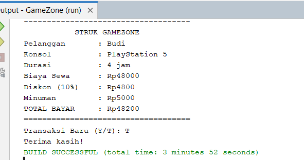

# GameZone Rental PlayStation

## Deskripsi
GameZone adalah aplikasi berbasis Java Console untuk menghitung biaya penyewaan PlayStation 4 dan PlayStation 5.

## Fitur
- Input nama pelanggan.
- Pilihan PS4 dan PS5.
- Perhitungan biaya sewa.
- Diskon 10% untuk durasi minimal 3 jam.
- Tambahan minuman Rp5.000.
- Struk pembayaran.
- Transaksi baru.

## Teknologi
- Java
- Apache NetBeans IDE

## Cara Menjalankan
1. Buka proyek GameZone di NetBeans.
2. Buka file GameZone.java.
3. Jalankan program.
4. Masukkan data pelanggan.

## Screenshot Output

## Pembuat
Nama: Dina Permatasari

Program Studi: Pendidikan Teknologi Informasi

Universitas Muhammadiyah Tasikmalaya
